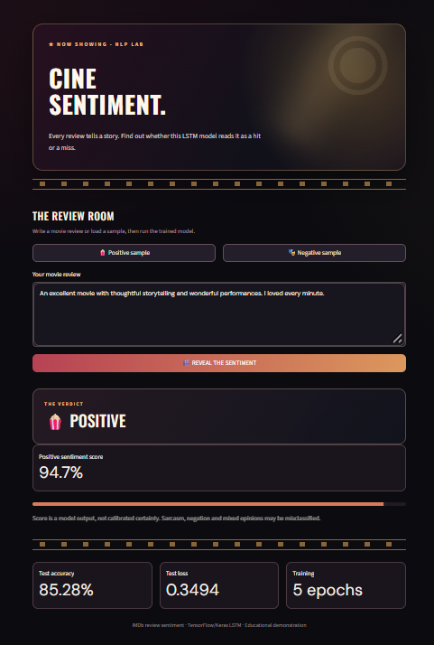

# 🎬 CineSentiment — IMDb Movie Review Sentiment Analysis

**A film-inspired interactive sentiment classifier powered by a TensorFlow/Keras LSTM.** Enter a movie review and get a positive or negative prediction in a cinematic Streamlit interface.

**Python 3.12 · TensorFlow · Keras · LSTM · Streamlit · IMDb · pytest**

**Live demo:** [cine-sentiment-imdb.streamlit.app](https://cine-sentiment-imdb.streamlit.app) · hosted on Streamlit Community Cloud.



## Training results

A **5-epoch** training run on CPU (Ubuntu WSL2, Python 3.12.3) produced:

| Metric | Result |
|---|---:|
| **Held-out test accuracy** | **85.2760%** |
| **Held-out test loss** | **0.3494** |
| Highest validation accuracy | 86.22% (epoch 5) |
| Lowest validation loss | 0.3337 (epoch 4) |
| Fit / validation / test samples | 20,000 / 5,000 / 25,000 |
| Epochs completed | 5 |

These figures are saved by the training run in [`models/metrics.json`](models/metrics.json). Validation loss increased slightly in epoch 5 while training loss kept decreasing, indicating possible early overfitting. Full epoch-by-epoch results: **[Training Results](docs/TRAINING_RESULTS.md)**. Model details: **[Model Card](docs/MODEL_CARD.md)**.

## Features

- IMDb binary movie-review classifier with 10,000-token vocabulary and 250-token input length
- 128-dimension embedding → 64-unit LSTM → sigmoid output
- Separate seeded validation partition from the original training data; original test partition reserved for evaluation
- Train / evaluate / export and text prediction commands
- Cinematic dark UI with movie-inspired visual styling and ready-made positive and negative examples
- Lightweight unit tests, GitHub Actions checks, and Dockerfile

## Repository layout

```text
app.py                           # Streamlit web app (deployment entrypoint)
requirements.txt                 # Runtime dependencies (installed by Streamlit Cloud)
pyproject.toml                   # Python package metadata
src/imdb_sentiment/              # Training, preprocessing and inference
models/                          # Trained artifacts loaded by the app
  sentiment_lstm.keras           # Saved Keras model
  metadata.json                  # Vocabulary index, vocab size and max sequence length
  metrics.json                   # Test metrics and epoch-by-epoch history
docs/TRAINING_RESULTS.md         # Epoch-by-epoch training results
docs/MODEL_CARD.md               # Model details and limitations
docs/images/                     # README screenshot
tests/                           # Preprocessing unit tests
.github/workflows/ci.yml         # Automated checks
.streamlit/config.toml           # Cinema theme
Dockerfile                       # Optional alternative deployment
```

## Run locally (Python 3.12 recommended)

From the project root:

```bash
python -m venv .venv
source .venv/bin/activate          # Windows: .venv\Scripts\activate
python -m pip install -r requirements.txt
python -m pip install -e . --no-deps
python -m streamlit run app.py
```

The app loads the trained model from `models/`. Open `http://localhost:8501` in your browser.

To retrain the model (this overwrites the files in `models/`):

```bash
python -m imdb_sentiment.train --epochs 5
```

For command-line prediction:

```bash
python -m imdb_sentiment.predict "A moving story with wonderful performances."
```

Run tests:

```bash
python -m pip install pytest
python -m pytest -q
```

## Limitations & license

Predictions are for English IMDb-style movie reviews, not calibrated certainty. The model can fail on sarcasm, nuanced reviews, slang, or out-of-domain text. This is a portfolio/educational demonstration, not a decision system.

MIT license; see [LICENSE](LICENSE).
